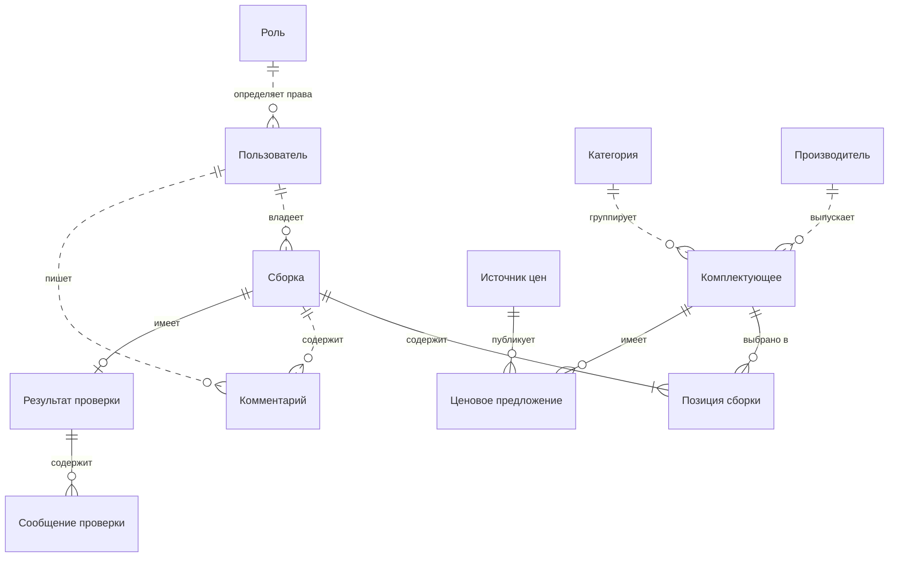
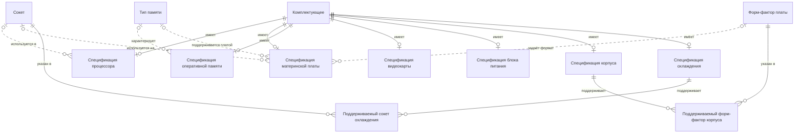
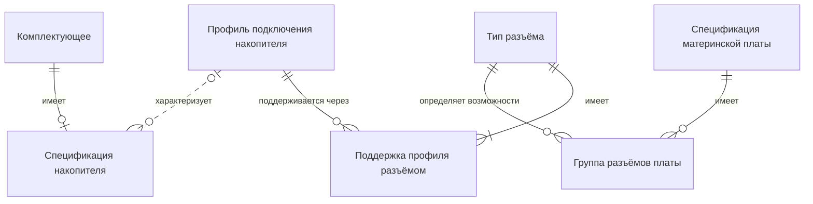

# Концептуальная схема данных конфигуратора ПК

Концептуальная модель описывает проектируемую структуру данных клиент-серверного конфигуратора. Она охватывает каталог, сохранение сборок, сравнение цен и проверку совместимости. Схема представлена в трёх частях. «Комплектующее» связывает каталог со спецификациями, а «Спецификация материнской платы» связывает параметры платформы с данными накопителей.

В нотации Crow’s Foot `||` означает «ровно один», `o|` — «ноль или один», `o{` — «ноль или много», `|{` — «один или много». Обозначение на конце линии показывает, сколько экземпляров этой сущности может соответствовать одному экземпляру на другом конце.

## 1. Пользователи, сборки и каталог

| Сущность | Назначение и основные сведения |
|---|---|
| Роль | Определяет права обычного пользователя или администратора. У каждого пользователя ровно одна роль. |
| Пользователь | Учётная запись с логином и признаком блокировки. Может владеть несколькими сборками. |
| Сборка | Именованная конфигурация одного пользователя. Пользователь может сохранить неполную или несовместимую сборку, если в ней выбрана хотя бы одна деталь. |
| Позиция сборки | Выбор одного комплектующего в одной сборке. Содержит количество единиц каталожной позиции. |
| Комментарий | Сообщение к одной сборке с одним автором. Писать могут владелец сборки и администратор. |
| Категория | Тип комплектующего, например процессор или видеокарта. Категория определяет, какую спецификацию получает карточка. |
| Производитель | Справочник брендов комплектующих. У каждой карточки указан один производитель. |
| Комплектующее | Карточка конкретной модели с базовой ценой, оценкой потребления и состоянием в каталоге. |
| Источник цен | Площадка, используемая для сравнения цен. Для демонстрации предложения могут формироваться на синтетических данных. |
| Ценовое предложение | Текущие цена и наличие одного комплектующего у одного источника. У одной пары «комплектующее — источник» не более одного предложения. |
| Результат проверки | Последняя сохранённая проверка сборки с отметкой времени. При сохранении через приложение результат обновляется, при открытии сервер проверяет сборку заново по актуальным данным. |
| Сообщение проверки | Ошибка или предупреждение, сформированное конкретным правилом. Успешная проверка может иметь пустой список сообщений. |

### Как связаны пользователь и комплектующее

**Пользователь 1 → 0..N Сборка 1 → 1..N Позиция сборки 0..N ← 1 Комплектующее.**

Пользователь может выбирать разные комплектующие в разных сборках, и одну модель могут выбирать разные пользователи. Связь «пользователь — комплектующее» прослеживается через владельца сборки и её состав. Ассоциативная сущность «Позиция сборки» разрешает M:N между сборкой и комплектующим двумя связями 1:N. Количество относится к позиции: один пользователь может указать два экземпляра SSD в рабочей сборке и один экземпляр той же модели в домашней.

Прямые связи M:N на диаграммах отсутствуют. Предложение связывает комплектующее и источник цен. Комментарий фиксирует отдельное действие автора в конкретной сборке, поэтому один автор может оставить в ней несколько сообщений.

## 2. Спецификации и параметры установки

Связь карточки с каждой спецификацией имеет кратность 1 : 0..1. Для каждой карточки в целом требуется ровно одна спецификация, соответствующая её категории. Спецификация может существовать при неизвестных отдельных характеристиках. Например, у видеокарты может быть неизвестна длина.

| Категория | Характеристики для подбора и проверки |
|---|---|
| Процессор | Сокет, число ядер и потоков. |
| Материнская плата | Сокет, тип памяти, число слотов и максимальный объём памяти, форм-фактор, группы разъёмов накопителей. |
| Оперативная память | Тип памяти, объём и число модулей в одной продаваемой позиции. |
| Видеокарта | Длина, объём видеопамяти. |
| Блок питания | Номинальная выходная мощность. |
| Корпус | Допустимая длина видеокарты, допустимая высота воздушного кулера, поддерживаемые форм-факторы плат. |
| Система охлаждения | Тип охлаждения, высота воздушного кулера, поддерживаемые сокеты. |
| Накопитель | Ёмкость и профиль подключения, показанный на следующей диаграмме. |

Сокеты, типы памяти и форм-факторы задаются справочниками. Корпус может поддерживать несколько форм-факторов, а кулер — несколько сокетов. Поэтому поддержку описывают отдельные строки для каждой пары «корпус — форм-фактор» и «охлаждение — сокет». Для списков поддержки предусмотрена отметка о полноте: отсутствие строки в подтверждённом списке означает отсутствие поддержки, отсутствие подтверждённого списка означает недостаток данных.

## 3. Подключение накопителей

Профиль задаёт конструктив и способ подключения накопителя, например кабельный SATA, M.2 SATA или M.2 PCIe/NVMe. Группа разъёмов платы задаёт количество одинаковых физических разъёмов. Один тип разъёма может принимать несколько профилей. Например, один комбинированный слот M.2 поддерживает SATA и NVMe, но одновременно вмещает только один накопитель. Отдельные строки поддержки описывают возможности слота, а количество задаётся один раз в группе разъёмов платы.

## 4. Правила предметной области

- **Состав сборки.** Для пары «сборка — комплектующее» существует одна позиция с положительным количеством. Если единица товара — комплект из двух модулей ОЗУ, то две единицы товара занимают четыре слота. Выбор нескольких процессоров, плат, блоков питания или корпусов фиксируется как ошибка проверки. Такую конфигурацию можно сохранить для дальнейшего редактирования.
- **Наличие и цены.** Администратор задаёт состояние карточки в каталоге. Наличие у каждого источника хранится в его предложении. Недоступную или снятую с ассортимента карточку нельзя добавить в новую позицию. В сохранённой сборке ссылка сохраняется, и сервер показывает предупреждение. Базовая стоимость рассчитывается по ценам каталога, а предложения используются для сравнения.
- **Проверка совместимости.** Сервер сравнивает сокеты, тип и объём ОЗУ, число модулей и слотов, поддерживаемый форм-фактор, габариты видеокарты и воздушного кулера, доступные подключения накопителей и мощность БП. Неизвестная характеристика даёт предупреждение по соответствующему правилу. Ошибки и предупреждения сохраняются вместе с последним результатом проверки.

Реляционные таблицы, ключи и ограничения приведены в [логической схеме](логическая-схема-бд.md).
