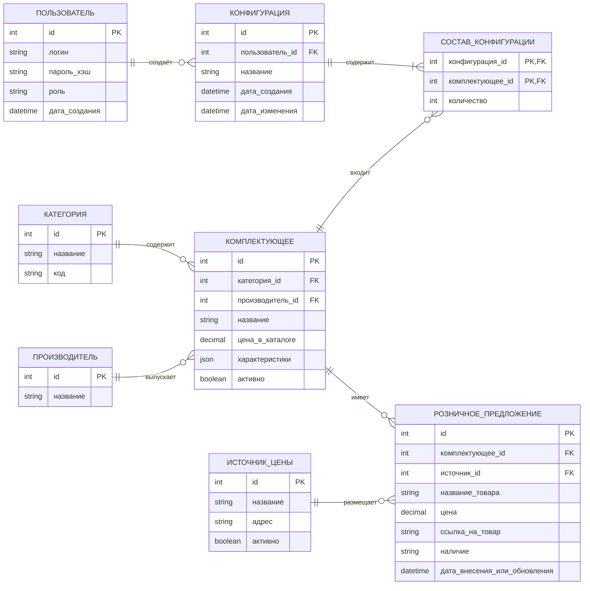

# Концептуальная схема данных «Конфигуратор ПК»

Я подготовил концептуальную схему, чтобы показать основные сущности предметной области и связи между ними. Базовая цена комплектующего используется для расчёта стоимости сборки, а внесённые администратором розничные предложения нужны для сравнения. Историю изменения цен в текущий объём проекта я не включаю. Правила совместимости реализуются серверной логикой, а не универсальной таблицей правил.

## Основные связи

- Один пользователь может иметь много сохранённых конфигураций.
- Одна конфигурация содержит несколько позиций комплектующих.
- Одно комплектующее может входить во множество конфигураций.
- Каждое комплектующее относится к категории и производителю.
- Базовая цена комплектующего используется при расчёте стоимости сборки и не дублируется в сущности розничного предложения.
- Для комплектующего может существовать несколько розничных предложений от разных источников. Предложение хранит текущую внесённую цену; при её обновлении прежнее значение не сохраняется.
- Строка состава связывает одну конфигурацию с одним комплектующим и хранит его количество. Пара «конфигурация — комплектующее» уникальна; повторное добавление того же комплектующего отражается количеством.
- Итоговая стоимость и энергопотребление конфигурации вычисляются по её составу и данным комплектующих, поэтому как сохраняемые поля конфигурации не дублируются.
- Проверки совместимости выполняет серверный модуль по характеристикам выбранных компонентов. Таблица универсальных правил с типом и текстовым описанием не задаёт исполняемых условий и в модель не включена.

Поле `цена_в_каталоге` — базовая цена комплектующего, вносимая и обновляемая через серверное приложение; автоматический сбор цен не предусматривается. Сущность истории цен и хранение прежних значений в текущей модели отсутствуют.
