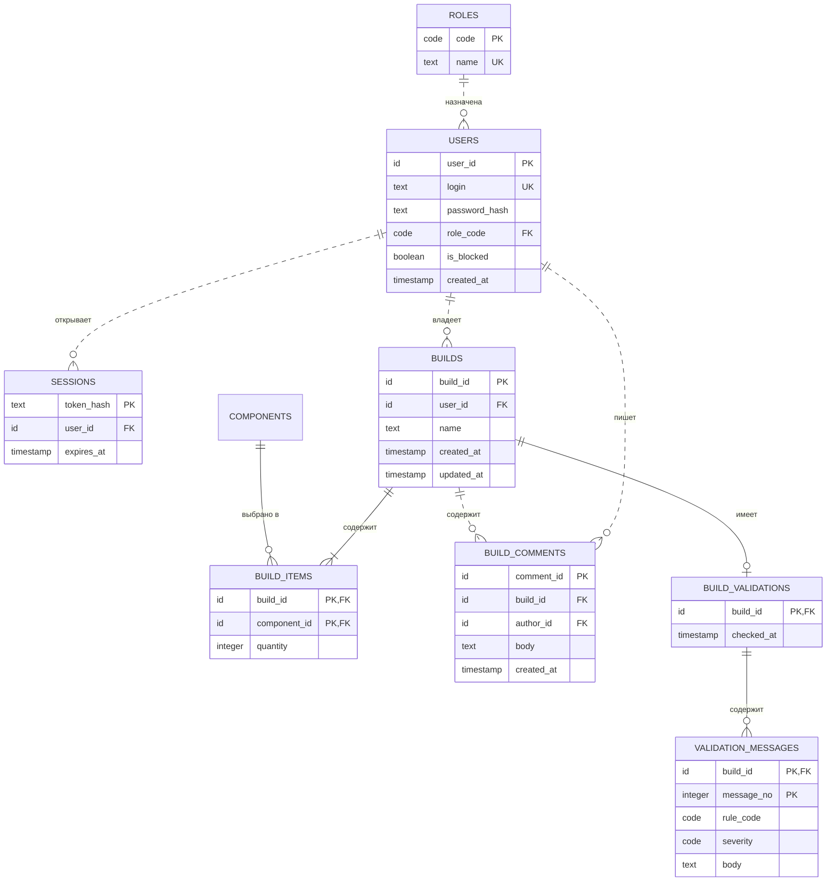
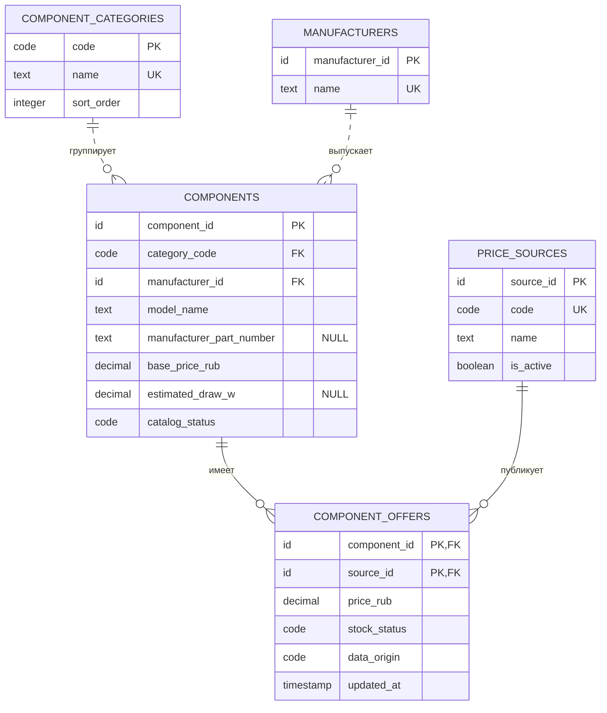
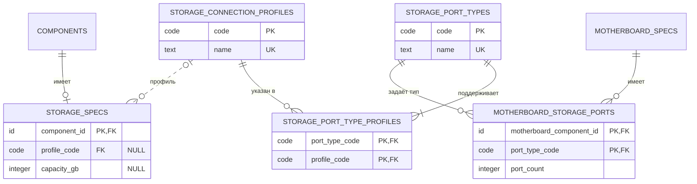

# Логическая схема базы данных конфигуратора ПК

Логическая схема переводит [концептуальную модель](концептуальная-схема.md) в реляционные таблицы. Она описывает проектируемую модель. Имена приведены в верхнем регистре на диаграммах и в нижнем регистре в тексте. Повторяющиеся узлы `COMPONENTS` и `MOTHERBOARD_SPECS` обозначают те же таблицы на разных рисунках.

`PK` — первичный ключ, `FK` — внешний ключ, `UK` — ограничение уникальности. Несколько полей с отметкой `PK` образуют один составной первичный ключ. `id`, `code`, `decimal` и `timestamp` обозначают логические типы идентификатора, кода, точного числового значения и момента времени. Сплошная линия обозначает включение внешнего ключа в первичный ключ зависимой таблицы, пунктирная обозначает отдельный внешний ключ. Поля обязательны, кроме отмеченных `NULL`. В спецификациях `NULL` обозначает неизвестную или неприменимую характеристику. Сервер различает эти случаи по правилу проверки и типу детали.

## 1. Учётные записи, сборки и проверки

| Таблица | Связи и ограничения |
|---|---|
| `roles`, `users` | `users.role_code → roles.code`. Роли `user` и `admin` задают права доступа. Логин уникален. Хранится хэш пароля. |
| `sessions` | `user_id → users.user_id`. Сеанс действителен до срока истечения при условии, что учётная запись активна. При блокировке пользователя сервер завершает его сеансы. |
| `builds` | `user_id → users.user_id`. Сборка принадлежит одному пользователю. При сохранении сервер проверяет непустой состав и записывает сборку вместе с её позициями и результатом проверки в одной транзакции. |
| `build_items` | `build_id → builds.build_id`, `component_id → components.component_id`. Составной ключ запрещает повтор одной модели в сборке. `quantity > 0`. |
| `build_comments` | `build_id → builds.build_id`, `author_id → users.user_id`. Автором может быть владелец этой сборки или администратор. Это правило доступа проверяет сервер. |
| `build_validations` | `build_id → builds.build_id`. Общий первичный и внешний ключ допускает максимум один сохранённый результат на сборку. Сервер записывает новый результат при сохранении состава. |
| `validation_messages` | `build_id → build_validations.build_id`. Сообщения нумеруются в пределах результата, `message_no > 0`. `severity` принимает `error` или `warning`. `rule_code` идентифицирует серверное правило. При обновлении результата сервер заменяет его сообщения в той же транзакции. |

Статус сохранённого результата определяется по его сообщениям. Если есть ошибка, сборка несовместима. Если есть только предупреждения, совместимость подтверждена не полностью. Если сообщений нет, все применимые проверки пройдены. При открытии сборки сервер заново вычисляет результат по актуальному каталогу. Сохранённый результат отражает состояние на момент указанной проверки.

## 2. Каталог, наличие и предложения

| Таблица | Связи и ограничения |
|---|---|
| `component_categories` | Восемь категорий `CPU`, `MOTHERBOARD`, `RAM`, `GPU`, `PSU`, `CASE`, `COOLER` и `STORAGE`. `sort_order` управляет порядком в подборщике. |
| `manufacturers` | Нормализованное название производителя уникально. |
| `components` | `category_code → component_categories.code`, `manufacturer_id → manufacturers.manufacturer_id`. Для указанного артикула уникальна пара `(manufacturer_id, manufacturer_part_number)`. Названия моделей могут повторяться. `base_price_rub ≥ 0`, известное `estimated_draw_w ≥ 0`. |
| `price_sources` | Справочник площадок с уникальным кодом. `is_active` управляет участием источника в текущем сравнении. |
| `component_offers` | `component_id → components.component_id`, `source_id → price_sources.source_id`. Составной ключ оставляет одно текущее предложение на пару. `price_rub > 0`. Значения `stock_status`: `in_stock`, `on_order`, `out_of_stock`, `unknown`. Значения `data_origin`: `manual` и `synthetic`. Время обновления фиксируется при записи текущей цены. |

`catalog_status` принимает `available`, `unavailable` или `retired`. По этому полю сервер решает, можно ли добавить позицию. В уже сохранённой сборке недоступная карточка остаётся видимой. `stock_status` относится к отдельной площадке, поэтому значения могут различаться даже для одной и той же детали.

Базовая стоимость сборки равна сумме `quantity × base_price_rub` по её позициям. Для сравнения сервер показывает базовую цену и текущие предложения активных источников, помечает синтетические значения и по запросу выделяет минимальную цену среди предложений со статусом `in_stock`. Если таких предложений нет, минимум для наличия не определён. При обновлении цены запись предложения заменяет предыдущее значение.

## 3. Спецификации платформы и габаритов

```mermaid
erDiagram
    COMPONENTS ||--o| CPU_SPECS : "имеет"
    COMPONENTS ||--o| MOTHERBOARD_SPECS : "имеет"
    COMPONENTS ||--o| RAM_SPECS : "имеет"
    COMPONENTS ||--o| GPU_SPECS : "имеет"
    COMPONENTS ||--o| PSU_SPECS : "имеет"
    COMPONENTS ||--o| CASE_SPECS : "имеет"
    COMPONENTS ||--o| COOLER_SPECS : "имеет"
    SOCKETS o|..o{ CPU_SPECS : "сокет"
    SOCKETS o|..o{ MOTHERBOARD_SPECS : "сокет"
    MEMORY_TYPES o|..o{ MOTHERBOARD_SPECS : "тип памяти"
    MEMORY_TYPES o|..o{ RAM_SPECS : "тип памяти"
    BOARD_FORM_FACTORS o|..o{ MOTHERBOARD_SPECS : "форм-фактор"
    CASE_SPECS ||--o{ CASE_BOARD_FORMS : "поддерживает"
    BOARD_FORM_FACTORS ||--o{ CASE_BOARD_FORMS : "указан в"
    COOLER_SPECS ||--o{ COOLER_SOCKETS : "поддерживает"
    SOCKETS ||--o{ COOLER_SOCKETS : "указан в"

    CPU_SPECS {
        id component_id PK, FK
        code socket_code FK "NULL"
        integer core_count "NULL"
        integer thread_count "NULL"
    }
    MOTHERBOARD_SPECS {
        id component_id PK, FK
        code socket_code FK "NULL"
        code memory_type_code FK "NULL"
        code board_form_factor_code FK "NULL"
        integer memory_slot_count "NULL"
        integer max_memory_gb "NULL"
        boolean storage_ports_complete
    }
    RAM_SPECS {
        id component_id PK, FK
        code memory_type_code FK "NULL"
        integer kit_capacity_gb "NULL"
        integer modules_per_kit "NULL"
    }
    GPU_SPECS {
        id component_id PK, FK
        decimal length_mm "NULL"
        integer vram_gb "NULL"
    }
    PSU_SPECS {
        id component_id PK, FK
        decimal rated_output_w "NULL"
    }
    CASE_SPECS {
        id component_id PK, FK
        decimal max_gpu_length_mm "NULL"
        decimal max_air_cooler_height_mm "NULL"
        boolean board_forms_complete
    }
    COOLER_SPECS {
        id component_id PK, FK
        code cooling_kind "NULL"
        decimal air_cooler_height_mm "NULL"
        boolean sockets_complete
    }
    SOCKETS {
        code code PK
        text name UK
    }
    MEMORY_TYPES {
        code code PK
        text name UK
    }
    BOARD_FORM_FACTORS {
        code code PK
        text name UK
    }
    CASE_BOARD_FORMS {
        id case_component_id PK, FK
        code form_factor_code PK, FK
    }
    COOLER_SOCKETS {
        id cooler_component_id PK, FK
        code socket_code PK, FK
    }
```

У всех таблиц `*_specs` поле `component_id` одновременно является первичным ключом и внешним ключом на `components.component_id`. У отдельной таблицы спецификаций максимум одна строка на компонент. При создании карточки сервер одной транзакцией записывает её и ровно одну спецификацию нужного типа. Категорию можно исправить до первого использования карточки в сборке. Сервер заменяет спецификацию в той же транзакции. Это ограничение охватывает восемь таблиц и проверяется целиком.

| Поля или таблицы | Связи и смысл |
|---|---|
| `cpu_specs.socket_code`, `motherboard_specs.socket_code` | `→ sockets.code`. Сокеты процессора и платы сравниваются по одному справочнику. |
| `motherboard_specs.memory_type_code`, `ram_specs.memory_type_code` | `→ memory_types.code`. Модель описывает один стандарт ОЗУ на плату. `kit_capacity_gb` и `modules_per_kit` относятся к одной каталожной единице товара. |
| `motherboard_specs.board_form_factor_code` | `→ board_form_factors.code`. Форм-фактор платы сравнивается со списком корпуса. |
| `case_board_forms` | `case_component_id → case_specs.component_id`, `form_factor_code → board_form_factors.code`. Ключ задаёт одну строку на пару «корпус — форм-фактор». |
| `cooler_sockets` | `cooler_component_id → cooler_specs.component_id`, `socket_code → sockets.code`. Ключ задаёт одну строку на пару «система охлаждения — сокет». |
| `cooler_specs.cooling_kind` | `air` или `liquid`. Высота воздушного кулера применима для `air`. Для жидкостного охлаждения посадка радиатора выходит за рамки этой проверки. |
| `psu_specs.rated_output_w` | Номинальная выходная мощность БП, измеряется в ваттах. `components.estimated_draw_w` описывает нагрузку от потребителей. Сам блок питания исключается из суммы. |

Известные количества модулей и габариты деталей положительны. Количество слотов и габаритные ограничения корпуса допускают ноль, если соответствующая установка невозможна. Номинальная мощность БП также положительна. Если указаны и число потоков, и число ядер, число потоков не меньше числа ядер. `board_forms_complete` и `sockets_complete` показывают, что список поддержки собран полностью. При неполном списке отсутствие совпадающей строки даёт предупреждение, при полном — ошибку.

## 4. Подключение накопителей

| Таблица | Связи и ограничения |
|---|---|
| `storage_specs` | `profile_code → storage_connection_profiles.code`. Профиль обозначает способ подключения и конструктив, например `SATA_CABLE`, `M2_SATA` или `M2_NVME`. |
| `storage_port_types` | Тип физического разъёма, например комбинированный слот M.2. Перед использованием типа сервер проверяет наличие хотя бы одного профиля поддержки. |
| `storage_port_type_profiles` | `port_type_code → storage_port_types.code`, `profile_code → storage_connection_profiles.code`. Составной ключ задаёт один факт поддержки на пару. |
| `motherboard_storage_ports` | `motherboard_component_id → motherboard_specs.component_id`, `port_type_code → storage_port_types.code`. `port_count > 0`. Количество относится к физически различным разъёмам. Один разъём учитывается в одной группе. |

Например, один комбинированный слот M.2 записывается в `motherboard_storage_ports` с количеством 1, а его тип связан с двумя профилями. Два выбранных накопителя с профилями SATA M.2 и NVMe M.2 нельзя одновременно назначить этому слоту. Для проверки сервер распределяет устройства по подходящим группам с учётом количества, в том числе при нескольких возможных назначениях. Если распределение невозможно и `storage_ports_complete = true`, известные подключения исчерпаны и это ошибка. Если список неполный или профиль накопителя неизвестен, неустановленная возможность подключения даёт предупреждение.

## 5. Как сервер проверяет сборку

| Проверка | Вычисление или условие |
|---|---|
| Состав | Суммарное количество процессоров, плат, БП и корпусов по каждой из этих категорий не превышает единицы. Отсутствие процессора, платы, ОЗУ, накопителя, БП или корпуса даёт предупреждение о неполном составе. Видеокарта и отдельный кулер проверяются, если выбраны. |
| Процессор, плата и кулер | Сокеты процессора и платы совпадают. Сокет процессора присутствует в списке поддержки выбранного кулера. |
| Оперативная память | Типы совпадают. `Σ(quantity × kit_capacity_gb) ≤ max_memory_gb` и `Σ(quantity × modules_per_kit) ≤ memory_slot_count`. |
| Плата и корпус | Форм-фактор платы присутствует в списке поддержки корпуса. |
| Видеокарта, кулер и корпус | Известная длина видеокарты укладывается в предел корпуса. Для воздушного кулера аналогично проверяется высота. |
| Накопители | Каждая единица товара получает один подходящий свободный разъём платы. Совместимость версий PCIe, длина M.2 и ограничения совместного использования линий остаются вне модели. |
| Мощность | Требуемый номинал БП равен `1,30 × Σ(quantity × estimated_draw_w)` для потребителей. Если известная часть потребления уже превышает номинал с учётом запаса, сервер выдаёт ошибку. При неполных данных и отсутствии такого превышения мощность считается неподтверждённой. |

## 6. Целостность и нормализация

- Удаление сборки удаляет её позиции, комментарии, результат проверки и его сообщения. При блокировке учётной записи её сборки и комментарии сохраняются. Удаление учётной записи с зависимыми сборками или комментариями ограничено.
- Снятие комплектующего с ассортимента меняет состояние карточки на `retired`. Физическое удаление карточки, на которую ссылается позиция, запрещено внешним ключом. При удалении неиспользуемой карточки её спецификация, строки поддержки и предложения удаляются вместе с ней. Применяемые значения справочников защищены внешними ключами.
- Атрибуты каждой таблицы определяются её ключом. Например, количество зависит от пары «сборка — комплектующее», а цена предложения — от пары «комплектующее — источник». Названия производителя и источника хранятся в справочниках. Состав, предложения и списки поддержки представлены отдельными строками. Базовая стоимость и ориентировочное потребление сборки вычисляются из состава и каталога. Такая структура соответствует третьей нормальной форме для указанных зависимостей.
